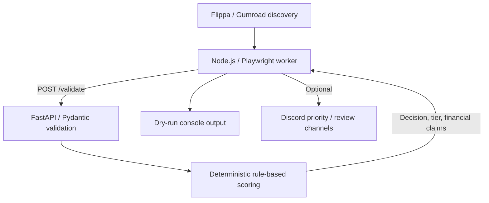

# Opportunity Scout

[](https://github.com/JoshkieChan/Opportunity-Scout/actions/workflows/ci.yml)

Opportunity Scout discovers Flippa and Gumroad listings, extracts asking prices and monthly financial claims, and applies deterministic rules to select opportunities for review. A Node.js worker handles browser automation and optional Discord alerts; a Python API validates and scores each listing.

## Architecture



| Service | Responsibility |
| --- | --- |
| Worker | Discover and deduplicate URLs per cycle, extract listing data, call the validator, rank results, optionally send alerts |
| Validator | Validate product JSON, identify the source by hostname, extract monthly amounts, apply scoring rules |
| Docker Compose | Run both services on a private network and start the worker after the validator is healthy |

Stack: Node.js 22+, Playwright/Chromium, discord.js, Python 3.12, FastAPI, Pydantic, Uvicorn, Docker Compose.

The API's `confidence` field is a **heuristic score** from 0–100. It is **not a probability, financial advice, or an AI prediction**. Financial values are unverified listing claims. See [scoring rules](docs/scoring.md) for thresholds and extraction formats.

## Local setup

Run from the repository root with Python 3.12 and Node.js 22 or newer:

```bash
python -m venv .venv
source .venv/bin/activate
# Windows PowerShell: .\.venv\Scripts\Activate.ps1
python -m pip install -r requirements-dev.txt
npm ci --prefix bot
cp .env.example .env
# Windows PowerShell: Copy-Item .env.example .env
python -m uvicorn validator.main:app --host 127.0.0.1 --port 8000
```

Open [interactive API documentation](http://127.0.0.1:8000/docs). In another terminal, `node scripts/smoke.js` sends fixture products through Node → FastAPI and asserts A, B, and C decisions.

### Dry-run and fixture modes

**Dry-run disables Discord delivery.** It still discovers live marketplace listings unless a fixture file is configured.

To run a repeatable local cycle without marketplace access or Discord credentials, set these values in the root `.env`:

```dotenv
DRY_RUN=true
RUN_ONCE=true
REQUEST_DELAY_MS=0
FIXTURE_PATH=fixtures/products.json
```

Run `node bot/index.js` from the root while the validator is running. Fixture mode bypasses browser discovery and scraping, but still uses the real validation API. The fixture file must contain a JSON array; malformed files stop startup.

For live discovery, remove `FIXTURE_PATH` and install Chromium with `node bot/node_modules/playwright/cli.js install chromium` (Linux: `install --with-deps chromium`). To enable Discord, set `DRY_RUN=false` and supply the token and both channel IDs. The bot needs View Channel and Send Messages permissions; privileged gateway intents are not required.

## Configuration

Copy `.env.example` to `.env`; keep real credentials out of Git. Local runs read the root `.env`. Compose uses it for interpolation and passes only the settings listed in its service definition.

| Variable | Default | Purpose |
| --- | --- | --- |
| `DISCORD_TOKEN` | unset | Required when Discord delivery is enabled |
| `CHANNEL_ID_PRIORITY` | unset | Tier A alerts and top-three summaries |
| `CHANNEL_ID_REVIEW` | unset | Tier B alerts |
| `DRY_RUN` | `true` in example/Compose; `false` otherwise | Disable Discord |
| `RUN_ONCE` | `false` | Exit after a single cycle |
| `VALIDATOR_URL` | `http://127.0.0.1:8000/validate` | Compose uses `http://validator:8000/validate` |
| `HTTP_TIMEOUT_MS` | `10000` | Validator request and Discord REST timeout |
| `CYCLE_INTERVAL_MS` | `600000` | Delay between cycles |
| `REQUEST_DELAY_MS` | `2000` | Delay between processed listings |
| `MAX_TARGETS_PER_CYCLE` | `30` | Maximum listings processed per cycle |
| `FIXTURE_PATH` | unset | JSON product array; requires dry-run mode |

Booleans accept only `true` or `false`. Numeric settings must be integers; timeouts and limits are positive, and request delay may be zero.

## Docker Compose

```bash
docker compose config --quiet
docker compose up --build -d
docker compose logs -f
docker compose down
```

Compose defaults to dry-run mode and contacts marketplaces. Both containers run as non-root users. The worker waits for `GET /health` before starting; the validator's port is internal to the Compose network. Use local Uvicorn for API exploration. The API has no authentication and is intended for a trusted local/private network.

For a credential-free fixture cycle in Docker:

```bash
docker compose build
docker compose up -d --wait validator
docker compose run --rm --no-deps -e DRY_RUN=true -e RUN_ONCE=true -e REQUEST_DELAY_MS=0 -e FIXTURE_PATH=/fixtures/products.json -v "./fixtures:/fixtures:ro" bot
docker compose down
```

The worker retries network errors, HTTP 429, and server errors up to three attempts with bounded request timeouts. Other HTTP errors fail without retry. Browser contexts close after each operation. SIGINT/SIGTERM interrupt the loop and close browser and Discord resources.

## API

| Endpoint | Response |
| --- | --- |
| `GET /health` | HTTP 200, `{"status":"ok"}` |
| `POST /validate` | HTTP 200 for approved or rule-rejected products; HTTP 422 for invalid input |
| `GET /docs` | Interactive OpenAPI documentation |

Example product:

```json
{
  "title": "Example SaaS business",
  "price": 850,
  "reviews": 12,
  "description": "Monthly revenue: $1.2K. Monthly profit: $400.",
  "url": "https://flippa.com/12345-example"
}
```

Responses include `approved`, `confidence`, `tier`, `source`, `monthly_revenue`, `monthly_profit`, and `reason`. Price must be positive and finite, reviews a non-negative integer, and URL an HTTP(S) address without credentials. Text fields have size limits; extra fields are rejected. Validation errors omit submitted values and unknown field names.

## Testing and CI

```bash
python -m pytest -q
python -m ruff check validator scripts
npm test --prefix bot
npm run check --prefix bot
node bot/node_modules/playwright/cli.js install chromium
npm run test:browser --prefix bot
npm audit --prefix bot
python -m pip_audit -r validator/requirements.txt
python scripts/scan_secrets.py
```

Tests cover parsing, scoring, validation, routing, retries, malformed data, and resource cleanup. Browser tests use intercepted fixture HTML. With a local validator running, `node scripts/smoke.js` checks actual HTTP communication. The secret scanner checks reachable Git history and current source files with redacted, pattern-based findings.

[GitHub Actions](https://github.com/JoshkieChan/Opportunity-Scout/actions/workflows/ci.yml) runs the tests, static checks, dependency audits, HTTP integration, Docker builds, Compose networking, fixture execution, graceful shutdown, and container Chromium checks. CI uses no Discord credentials or live marketplace requests.

## Limitations

- Marketplace selectors, rendering timing, rate limits, login gates, and anti-bot defenses can change. Live marketplace discovery and Discord delivery are not covered by the offline tests.
- Price extraction prefers product metadata, then falls back to the first dollar amount in body text. The fallback can mistake a financial claim for an asking price. Explicit non-USD metadata is rejected; unlabelled dollar text is assumed USD.
- Keyword rules and regex extraction can miss valid listings or accept misleading claims. Negative profit and ambiguous periods are not modeled.
- Gumroad listings may be licenses rather than transferable businesses. Approval does not establish ownership or resale rights.
- Deduplication is per cycle. There is no persistent alert history or guaranteed delivery; repeat alerts across cycles are possible.
- Node dependencies are locked; Python direct dependencies are pinned, while transitive dependencies are resolved during installation and audited in CI.
